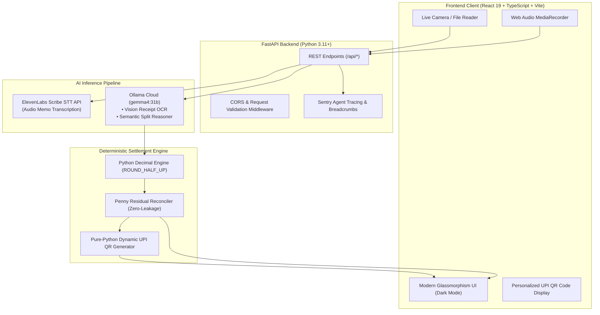

# 🧾⚡ ChaoticSplitter

<div align="center">

> **Never let an LLM do arithmetic.**  
> An open-source, multimodal AI bill-splitting engine built with **Google Gemma 4**, **ElevenLabs Scribe STT**, **FastAPI**, and **React 19** that turns crumpled receipts and chaotic voice memos into mathematically flawless, zero-leakage settlements with instant UPI QR payments.

[](https://chaoticsplitter.vercel.app)
[](http://127.0.0.1:8000/api/health)
[](LICENSE)

<br/>

[](https://fastapi.tiangolo.com)
[](https://react.dev)
[](https://www.typescriptlang.org)
[](https://ai.google.dev/gemma)
[](https://ollama.com)
[](https://elevenlabs.io)
[](https://sentry.io)
[](https://vite.dev)

</div>

---

## 📑 Table of Contents

- [The Problem & Vision](#-the-problem--vision)
- [Key Features](#-key-features)
- [How It Works (User Journey)](#-how-it-works-user-journey)
- [System Architecture](#-system-architecture)
- [Deep Dive: AI & Zero-Leakage Hybrid Engine](#-deep-dive-ai--zero-leakage-hybrid-engine)
- [Technical Highlights](#-technical-highlights)
- [Project Directory Structure](#-project-directory-structure)
- [API Reference](#-api-reference)
- [Getting Started Locally](#-getting-started-locally)
- [Environment Variables](#-environment-variables)
- [Production Deployment](#-production-deployment)
- [Contributing & License](#-contributing--license)

---

## 🎯 The Problem & Vision

Splitting group dinner checks, vacation expenses, and chaotic bar tabs is notoriously painful:

- 🍕 **Complex Human Realities:** *"Alice and Bob shared the pasta, Charlie had a cocktail, David arrived late and ate half the garlic bread, and there was an 18% service charge plus a 15% happy hour voucher."*
- 🧮 **LLMs Hallucinate Math:** Pure LLM agents frequently invent cents, double-count taxes, drop rounding residuals, or produce unbalanced totals where the sum of individual shares does not equal the receipt grand total.
- 📱 **Friction at Settlement:** After tedious spreadsheet calculations, people still have to manually type UPI IDs or account numbers, causing unpaid tabs to linger for days.

### The Solution: A Hybrid Multimodal Architecture
**ChaoticSplitter** enforces a strict separation of concerns:
1. **Multimodal AI (Google Gemma 4 & ElevenLabs Scribe)** handles perception, vision OCR on crumpled receipts, and semantic extraction of natural human speech.
2. **Deterministic Python `decimal.Decimal` Math Engine** calculates 100% of the proportional taxes, discounts, service charges, and zero-leakage penny reconciliation.
3. **Dynamic UPI QR Engine** instantly produces personalized payment codes for every participant to scan and pay on the spot.

---

## ✨ Key Features

| Feature | Description |
| :--- | :--- |
| 📸 **Multimodal Receipt OCR** | Snaps or uploads thermal restaurant bills and extracts clean line items, quantities, subtotal, taxes, and service charges via **Gemma 4 Vision**. |
| 🎙️ **Voice Memo Splitting (Scribe STT)** | Record how you want to split in plain language. Transcribed with ultra-high accuracy using **ElevenLabs Scribe STT** and mapped to participants using **Gemma 4**. |
| ⚖️ **Zero-Leakage Penny Reconciliation** | Guarantees that the sum of all individual shares strictly matches the receipt grand total down to the exact cent using `decimal.Decimal` and `ROUND_HALF_UP`. |
| 📱 **Personalized UPI QR Codes** | Generates dynamic, scan-ready UPI QR codes (GPay, PhonePe, Paytm, BHIM) and 1-tap deep links for every non-payer. |
| 💬 **1-Click WhatsApp Summary** | Formats an emoji-rich, markdown-styled payment breakdown ready to paste directly into your friend group chat. |
| 🔭 **Sentry Distributed Agent Tracing** | Full telemetry across AI pipeline spans (`ai.stt`, `ai.ocr`, `ai.llm`, `math.settlement`) with breadcrumbs and error captures. |

---

## 🔄 How It Works (User Journey)

```text
  ┌─────────────────────────────────────────────────────────────────────────────┐
  │                           0. GROUP SETUP (VOICE / TEXT)                     │
  │  Tap record: "Goa trip with Alice, Bob, and Charlie". ElevenLabs Scribe STT │
  │  transcribes and Gemma 4 structures the participant roster.                 │
  └──────────────────────────────────────┬──────────────────────────────────────┘
                                         │
                                         ▼
  ┌─────────────────────────────────────────────────────────────────────────────┐
  │                           1. SNAP RECEIPT (CAMERA / UPLOAD)                 │
  │  Camera capture parses crumpled thermal paper. Gemma 4 Vision OCR extracts  │
  │  dishes, quantities, subtotal, and tax totals.                              │
  └──────────────────────────────────────┬──────────────────────────────────────┘
                                         │
                                         ▼
  ┌─────────────────────────────────────────────────────────────────────────────┐
  │                           2. EXPLAIN SPLIT (SPEAK OR TYPE)                  │
  │  Record natural speech: "Alice & Bob shared pizza, Charlie had soup, split  │
  │  drinks equally". Gemma 4 maps allocations and sharing weights.             │
  └──────────────────────────────────────┬──────────────────────────────────────┘
                                         │
                                         ▼
  ┌─────────────────────────────────────────────────────────────────────────────┐
  │                           3. VERIFY & FINE-TUNE (LIVE CHIPS)                │
  │  Interactive UI checklist: tap friend pills beside any dish. Python Decimal │
  │  recalculates instantly with real-time "ZERO-LEAKAGE VERIFIED" badge.       │
  └──────────────────────────────────────┬──────────────────────────────────────┘
                                         │
                                         ▼
  ┌─────────────────────────────────────────────────────────────────────────────┐
  │                           4. SETTLE & PAY (1-TAP UPI QR CODES)              │
  │  Select who paid. Non-payers scan personalized dynamic UPI QR codes.        │
  │  Export formatted WhatsApp breakdown with a single click.                   │
  └─────────────────────────────────────────────────────────────────────────────┘
```

---

## 🏛️ System Architecture



---

## 🤖 Deep Dive: AI & Zero-Leakage Hybrid Engine

### 1. The Cardinal Rule: Never Let an LLM Do Arithmetic
Language models excel at fuzzy human context:
- Deciphering faded thermal receipts with OCR artifacts (`"Mshrm Pzza 1x 450.00"`).
- Resolving conversational instructions (`"We split the dessert three ways, but Rahul only took one bite"`).

However, neural networks are probabilistic token predictors, not calculators. Delegating math to an LLM produces rounding drift and leaked cents. In ChaoticSplitter, Gemma 4 is strictly constrained to **semantic mapping**: it outputs an item-to-participant allocation matrix with relative consumption weights.

### 2. The Zero-Leakage Settlement Algorithm
All financial mathematics are executed by Python's `decimal.Decimal` engine:

$$\text{Individual Item Share} = \text{Item Price} \times \left( \frac{\text{Weight}_i}{\sum \text{Weights}} \right)$$

$$\text{Proportional Tax Share}_i = \text{Tax Total} \times \left( \frac{\text{Subtotal}_i}{\text{Subtotal}_{\text{all}}} \right)$$

$$\text{Final Grand Total} = \sum_{i=1}^{N} \text{Person Total}_i$$

Any lingering sub-cent rounding residual is systematically credited to or deducted from the largest consumption share, guaranteeing mathematical zero-leakage proof:
$$\sum \text{Allocated Shares} \equiv \text{Printed Receipt Grand Total}$$

---

## ⚡ Technical Highlights

### 1. Pure-Python Dynamic UPI QR Generator
UPI QR codes are dynamically generated server-side using standard payment specification payloads:
```
upi://pay?pa={vpa}&pn={payer}&am={amount}&cu=INR&tn={bill_note}
```
Wrapped with resilient Pillow / PyPNG fallback handlers to ensure faultless image rendering on all operating systems.

### 2. Sentry Agent Distributed Tracing
Instrumented with granular child spans across every stage:
- `ai.stt.elevenlabs` — Audio memo processing
- `ai.ocr.vision` — Multimodal receipt OCR
- `ai.llm.gemma.group_extract` — Participant roster extraction
- `ai.llm.gemma.split_plan` — Semantic rule reasoning
- `math.settlement` — Zero-leakage decimal balancing

### 3. Glassmorphic Responsive Frontend
Built with React 19 and raw CSS design tokens (no Tailwind bloat). Optimized for mobile smartphones with live touch-friendly participant pills, camera preview drawers, and responsive scrollable balance sheets.

---

## 📁 Project Directory Structure

```text
chaoticSplitter/
├── backend/
│   ├── requirements.txt             # Ultra-lightweight dependencies (<60MB RAM)
│   ├── .env.example                 # Example environment variables template
│   ├── .env                         # Local secrets (git-ignored)
│   └── app/
│       ├── main.py                  # FastAPI REST routes, CORS & telemetry
│       ├── config.py                # Environment configuration loader
│       ├── schemas.py               # Pydantic v2 data contracts
│       ├── math_engine.py           # Zero-leakage Decimal math & UPI QR generator
│       ├── telemetry.py             # Sentry SDK agent tracing & breadcrumbs
│       └── services/
│           ├── stt_service.py       # ElevenLabs Scribe STT integration
│           ├── ocr_service.py       # Ollama Cloud Gemma 4 Vision OCR
│           ├── gemma_service.py     # Gemma 4 participant extraction
│           └── split_service.py     # Gemma 4 semantic rule reasoner
│
├── frontend/
│   ├── package.json                 # Node dependencies (React 19, Lucide, Axios)
│   ├── vite.config.ts               # Vite configuration & backend proxy
│   ├── tsconfig.json                # TypeScript compiler configuration
│   └── src/
│       ├── App.tsx                  # Main 4-step workflow orchestrator
│       ├── index.css                # Global responsive dark-theme design tokens
│       ├── main.tsx                 # React DOM mount point
│       ├── types/
│       │   └── index.ts             # TypeScript interfaces mirroring Pydantic models
│       ├── services/
│       │   └── api.ts               # Resilient Axios backend client
│       └── components/
│           ├── navbar.tsx           # Header with backend connectivity badge
│           ├── footer.tsx           # Footer with hackathon credits
│           ├── groupSetup.tsx       # Step 0: Voice & text group roster creation
│           ├── snapReceipt.tsx      # Step 1: Camera capture & receipt OCR preview
│           ├── receiptPreviewPanel.tsx # Reference drawer with receipt preview
│           ├── explainSplit.tsx     # Step 2: Voice memo recorder & text prompt
│           ├── verifyItems.tsx      # Step 3: Interactive fine-tuning & live math
│           └── settlePay.tsx        # Step 4: UPI payment QR codes & WhatsApp share
│
└── README.md                        # Project documentation
```

---

## 🔌 API Reference

### Health & Diagnostics
- `GET /api/health` — Service health check & active telemetry status.
- `GET /api/sentry-test` — Triggers a test span and breadcrumb in Sentry.

### Core Pipelines
- `POST /api/transcribe` — Transcribes raw audio using ElevenLabs Scribe STT.
- `POST /api/groups` — Transcribes voice and extracts group name & member array via Gemma 4.
- `POST /api/receipts` — Receives receipt image, runs Gemma 4 Vision OCR, and returns structured `ReceiptSchema`.
- `POST /api/split-plan` — Translates natural language splitting instructions into item shares via Gemma 4.
- `POST /api/verify` — Executes zero-leakage Decimal calculation and returns complete `SettlementSummary`.
- `POST /api/settle` — Produces dynamic UPI QR codes and payment deep links for all non-payers.

---

## 💻 Getting Started Locally

### Prerequisites
- **Node.js** (v18+) & **npm**
- **Python** (v3.11+)
- Virtual environment tool (`venv` or `conda`)

### 1. Clone the Repository
```bash
git clone https://github.com/rajanikant04/chaoticSplitter.git
cd chaoticSplitter
```

### 2. Backend Setup
```bash
cd backend
python -m venv venv

# Activate Virtualenv:
# Windows (PowerShell):
.\venv\Scripts\activate
# macOS / Linux:
source venv/bin/activate

# Install dependencies (Lightweight, no heavy PyTorch memory bloat):
pip install -r requirements.txt

# Configure environment variables:
cp .env.example .env
```

Edit your `backend/.env` file:
```ini
# Ollama Cloud (Gemma 4 text reasoning & Vision OCR)
OLLAMA_API_KEY=your_ollama_api_key_here
OLLAMA_BASE_URL=https://ollama.com
OLLAMA_MODEL=gemma4:31b
OCR_MODEL=gemma4:31b

# ElevenLabs (Scribe STT for voice memos)
ELEVENLABS_API_KEY=your_elevenlabs_api_key_here

# Sentry Agent Tracing & Observability
SENTRY_DSN=https://your_sentry_dsn_here
```

Start the FastAPI server:
```bash
uvicorn app.main:app --reload --port 8000
```
API docs will be interactive at `http://127.0.0.1:8000/docs`.

### 3. Frontend Setup
In a new terminal window:
```bash
cd frontend
npm install
npm run dev
```
Open `http://localhost:5173` in your browser.

---

## ⚙️ Environment Variables

Create a `backend/.env` file:

| Variable | Default | Description |
| :--- | :--- | :--- |
| `OLLAMA_API_KEY` | *None* | Ollama Cloud API Key for Gemma 4 models |
| `OLLAMA_BASE_URL` | `https://ollama.com` | Base URL for Ollama Cloud API |
| `OLLAMA_MODEL` | `gemma4:31b` | Gemma model ID for conversational reasoning |
| `OCR_MODEL` | `gemma4:31b` | Multimodal vision model ID for receipt OCR |
| `ELEVENLABS_API_KEY` | *None* | Key for ElevenLabs Scribe speech-to-text |
| `SENTRY_DSN` | *None* | Sentry project DSN for distributed tracing |
| `ENVIRONMENT` | `development` | Deployment environment tag (`production`, `staging`) |
| `CORS_ORIGINS` | `http://localhost:5173` | Comma-separated list of allowed frontend origins |

*(Optional frontend variable in `frontend/.env.local`)*:
| Variable | Default | Description |
| :--- | :--- | :--- |
| `VITE_API_BASE_URL` | *Empty (uses Vite proxy)* | Direct production backend URL (e.g. `https://chaoticsplitter-backend.onrender.com`) |

---

## 🚀 Production Deployment

### Option A: Render (Backend) + Vercel (Frontend)

1. **Deploy Backend on [Render](https://render.com):**
   - Click **New +** $\rightarrow$ **Web Service**.
   - Root Directory: `backend`
   - Runtime: `Python 3`
   - Build Command: `pip install -r requirements.txt`
   - Start Command: `uvicorn app.main:app --host 0.0.0.0 --port $PORT`
   - Memory Profile: **<60MB RAM** (Seamlessly stays well within Render's 512MB free tier!).
   - Add Environment Variables: `OLLAMA_API_KEY`, `ELEVENLABS_API_KEY`, `SENTRY_DSN`, `ENVIRONMENT=production`.

2. **Deploy Frontend on [Vercel](https://vercel.com):**
   - Import repository with **Root Directory** set to `frontend`.
   - Set environment variable: `VITE_API_BASE_URL=https://your-backend.onrender.com`.
   - Build Command: `npm run build`
   - Output Directory: `dist`
   - Click **Deploy**!

---

## 🤝 Contributing & License

Contributions, bug reports, and suggestions are warmly welcomed!

1. Fork the Project.
2. Create your Feature Branch (`git checkout -b feature/CoolSplitFeature`).
3. Commit your Changes (`git commit -m "feat: add multi-currency exchange conversion"`).
4. Push to the Branch (`git push origin feature/CoolSplitFeature`).
5. Open a Pull Request.

Distributed under the **MIT License**. See [LICENSE](LICENSE) for details.

---

<div align="center">
  <sub>Built with mathematical precision and zero leakage for Hacktoberfest & DEV Challenges. Split fairly, settle instantly. 🧾⚡</sub>
</div>
